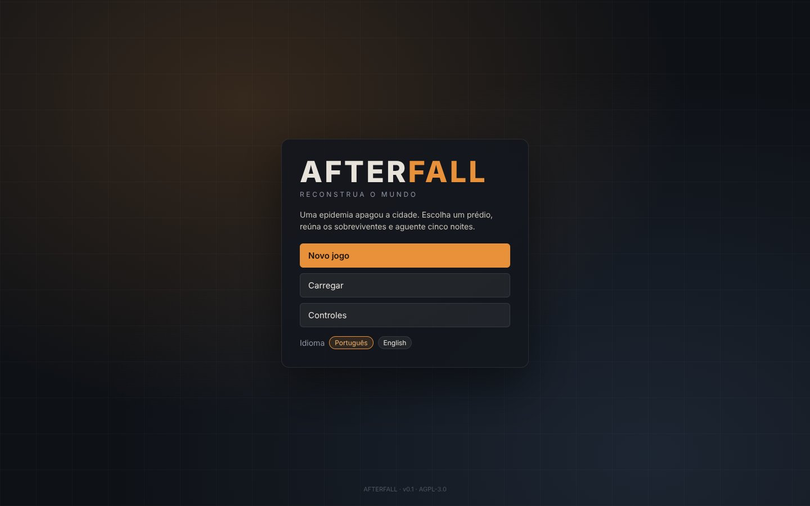
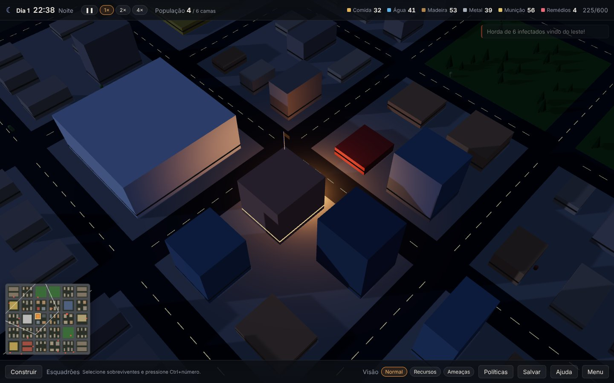
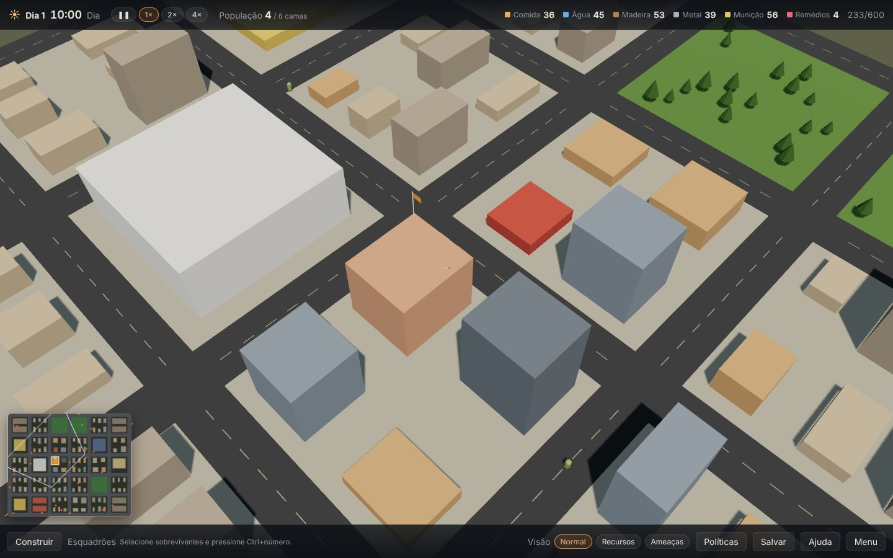
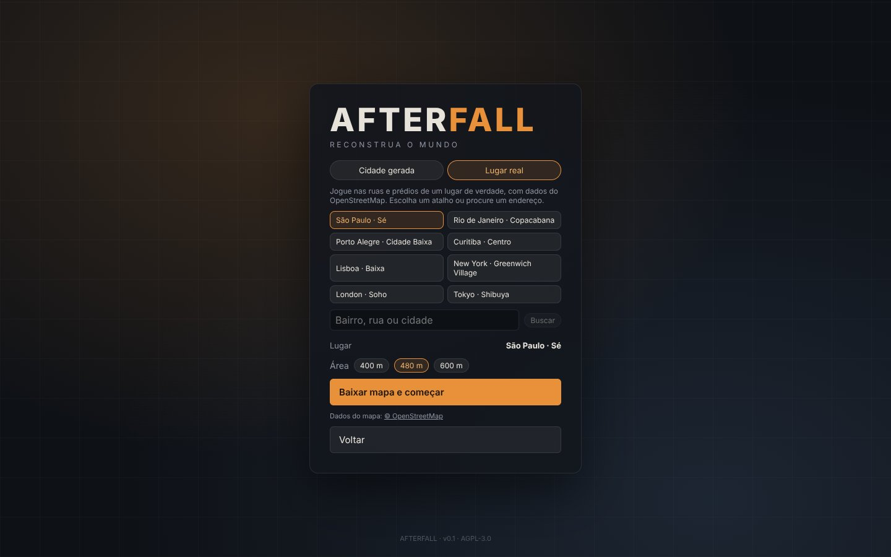

<p align="center">
  
</p>

<h1 align="center">AFTERFALL</h1>

<p align="center"><strong>Scavenge by day. Hold by night. Rebuild the world.</strong></p>

<p align="center">
  <a href="https://gamestudio42.github.io/afterfall/"></a>
  <a href="https://github.com/gamestudio42/afterfall/actions/workflows/pages.yml"></a>
  <a href="https://github.com/gamestudio42/afterfall/stargazers"></a>
  <a href="https://github.com/gamestudio42"></a>
</p>

<p align="center">
  A 3D survival RTS and colony builder in a city emptied by an outbreak, in the browser. You lead a
  handful of survivors, turn an abandoned building into a headquarters, scavenge the streets by day
  and fortify before the infected come at night. Play on a generated city or on the real streets of
  any place in OpenStreetMap. No installation is needed to play.
</p>

<p align="center">
  <a href="https://gamestudio42.github.io/afterfall/">
    
  </a>
</p>

<p align="center">
  <a href="https://gamestudio42.github.io/afterfall/">
    
  </a>
</p>

## Survive five nights

1. **Choose a headquarters.** Any building can become the base. It holds six beds and 600 storage
   and keeps half of what was inside. A large central building is rich; a compact one is easier to wall in.
2. **Scavenge by day.** Send survivors into houses, shops, hospitals and police stations. Disturbing a
   building releases the infected hiding inside; searching it reveals loot to carry home. Rich places
   are full of infected, safe ones are poor.
3. **Build and adapt.** Walls, gates, watchtowers, gardens and wells go up on the streets; buildings
   become shelters, storage or a workshop that turns metal into ammo. Automatic survivors pick up the
   jobs on their own.
4. **Hold the night.** Hordes enter from the edge of the city at 21:00, 23:30 and 02:00 and break
   the weakest wall on their way to the base. Gunfire kills fast but its noise draws more of them.
5. **Count the cost at dawn.** Medicine cures bites before the infected turn, morale settles, the
   game autosaves and the surviving horde retreats. Reach the sixth dawn to win; lose the base and
   it is over.

Every survivor has health, hunger, fatigue, morale and skills that improve with use. The simulation is
deterministic: the same seed and orders always play out the same way, which keeps saves and the
balance runs exact.

## See the city

<p align="center">
  
</p>

<table>
<tr>
<td align="center" width="50%" valign="top">
<br>
Day one: the flag goes up on the headquarters and the scavengers head out.
</td>
<td align="center" width="50%" valign="top">
<br>
Real place: download any neighbourhood from OpenStreetMap and play on it.
</td>
</tr>
</table>

## Play

Open **[gamestudio42.github.io/afterfall](https://gamestudio42.github.io/afterfall/)** and choose
**Novo jogo**. **Cidade gerada** builds a procedural city from a seed; **Lugar real** lets you pick a
shortcut (São Paulo, Rio, Porto Alegre, Curitiba, Lisbon, New York, London, Tokyo) or search an
address, then turns that area's streets and buildings into the map. Buildings keep their real shapes,
and hospitals, police stations, schools, supermarkets and shops come from the map data.
The interface is in Portuguese by default; English is on the main menu.

| Action                   | Shortcut                                                 |
| ------------------------ | -------------------------------------------------------- |
| Move camera             | `WASD`, arrows or screen edge                            |
| Zoom / rotate           | wheel / right drag, `Q` `E`                              |
| Select                  | left click or drag (`Shift` adds)                        |
| Move / scavenge / attack | right click on the ground, a building or an infected     |
| Pause / speed           | `Space` / `Shift` + `1–4` (pause, 1×, 2×, 4×)            |
| Squads                  | `Ctrl` + `1–9` forms, `1–9` selects                      |
| Focus / home / cancel   | `F` / `H` / `Esc`                                        |
| Diagnostics             | `F3` (FPS, tick time, entities, draw calls, memory)      |

Games save in the browser and autosave at every dawn. Downloaded map areas are cached in the browser too.

## Develop

Requires Node.js 22+ and pnpm 10.

```sh
pnpm install
pnpm dev        # http://localhost:5173
```

| Command                                  | Purpose                                                    |
| ---------------------------------------- | ---------------------------------------------------------- |
| `pnpm typecheck`                         | TypeScript over the whole monorepo                         |
| `pnpm test`                              | Vitest: world generation and simulation tests              |
| `pnpm test:e2e`                          | Playwright browser workflows (starts the dev server)       |
| `pnpm build`                             | Static build in `apps/web/dist`, relative paths            |
| `pnpm sim [seed] [days]`                 | Headless game with a scripted player, prints a JSON report |
| `pnpm sweep [seeds] [first] [open\|fort]` | Win rates of both scripted players over many seeds         |

Every push to `main` runs the checks and publishes `apps/web/dist` to GitHub Pages. Every pull request
from this repository also gets a playable preview at
`https://gamestudio42.github.io/afterfall/pr-preview/pr-<number>/`, linked in a comment on the PR and
removed when it closes. The build uses relative paths, so it runs from any folder.

The simulation lives in `packages/core`, a deterministic TypeScript package with a seeded RNG that never
touches Three.js or the DOM. `packages/world` generates the city or imports it from OpenStreetMap, the
Three.js renderer and the React interface only send commands and read state. See the
[game design](docs/GDD.md), [architecture](docs/ARCHITECTURE.md), [systems](docs/SYSTEMS.md),
[roadmap](docs/ROADMAP.md), [testing](docs/TESTING.md), [decisions](docs/DECISIONS.md) and the
[rules for agents](docs/AGENTS.md).

## Licence

AFTERFALL is free software under the GNU Affero General Public License, version 3 or any later
version ([`AGPL-3.0-or-later`](LICENSE)), following the
[Game Studio 42](https://github.com/gamestudio42) default for complete games. If you run a modified
version for other people, including as a website or over a network, you must offer them its source
under the same licence. Copyright (c) 2026 Marcel Savegnago.

Its code, city generator, rules and procedural art are original; the game draws on city builders,
wave-defence RTS and survival sandboxes as genres, and no code or assets were copied. Asset licensing
will be defined separately. Real maps use data © [OpenStreetMap contributors](https://www.openstreetmap.org/copyright),
available under the ODbL; the game shows this attribution while you play on one. See [LICENSE](LICENSE) and
[docs/AGENTS.md](docs/AGENTS.md) for project rules.
